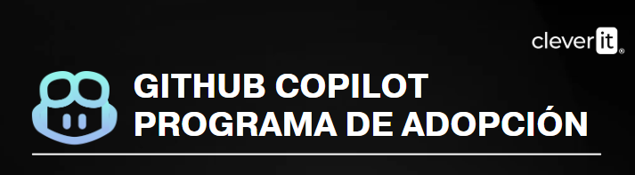

<div align="center">


# 🚀 Workshop 1 — GitHub Copilot CLI: Setup and Interactive Mode

**Hands-on installation, authentication, Trust Model, context, and codebase exploration**

**⏱️ Total duration: 90 minutes**

</div>

---

This hands-on workshop takes participants from installing **GitHub Copilot CLI** to their first real working session on the workshop repository. The focus is on running, validating, and experimenting with the agent from the terminal; theory is limited to what is strictly necessary to complete the labs.

> [!TIP]
> Always work inside the specific project directory. The Trust Model allows the agent to operate on the contents of the directory from which it was launched.

---

## 📋 Table of Contents

1. [🎯 Learning objectives](#-learning-objectives)
2. [⏱️ Estimated duration](#️-estimated-duration)
3. [📚 Prerequisites](#-prerequisites)
4. [🧰 Step 1. Install and verify GitHub Copilot CLI](#-step-1-install-and-verify-github-copilot-cli)
5. [🔐 Step 2. Authenticate, clone the repo, and validate the Trust Model](#-step-2-authenticate-clone-the-repo-and-validate-the-trust-model)
6. [🩺 Step 3. Validate the CLI's initial state](#-step-3-validate-the-clis-initial-state)
7. [🔎 Step 4. Explore the codebase in Normal Mode](#-step-4-explore-the-codebase-in-normal-mode)
8. [📎 Step 5. Attach context and analyze a file](#-step-5-attach-context-and-analyze-a-file)
9. [🧭 Step 6. Use Plan Mode without running changes](#-step-6-use-plan-mode-without-running-changes)
10. [📝 Step 7. Generate documentation and share the session](#-step-7-generate-documentation-and-share-the-session)
11. [✅ Completion checklist](#-completion-checklist)
12. [🧭 Final reflections](#-final-reflections)

---

## 🎯 Learning objectives

By the end of this workshop, you will be able to:

- ✅ Install and verify **GitHub Copilot CLI** from the terminal.
- ✅ Authenticate using `/login` and understand the **Trust Model** of the working directory.
- ✅ Properly clone and open the workshop repository before starting the agent.
- ✅ Use `/changelog`, `/version`, and `/model` to validate the session state.
- ✅ Use **Normal Mode** to explore a codebase's architecture.
- ✅ Attach files with `@...` to provide explicit context to the agent.
- ✅ Switch to **Plan Mode** with `Shift+Tab`, review a plan, and cancel it with `Ctrl+C` before modifying code.
- ✅ Generate project documentation and share a session with `/share`.

---

## ⏱️ Estimated duration

> [!NOTE]
> The schedule below adapts the original material into a **90-minute hands-on workshop**. The times are focused on execution and validation, not theoretical presentation.

| Section | Time |
| --- | ---: |
| 🧰 Installation and verification | 20 min |
| 🔐 Authentication, cloning, and Trust Model | 20 min |
| 🩺 Initial CLI state | 10 min |
| 🔎 Codebase exploration in Normal Mode | 15 min |
| 📎 Explicit context with `@file` | 10 min |
| 🧭 Plan Mode and controlled cancellation | 10 min |
| 📝 README + `/share` + wrap-up | 5 min |
| **Total** | **90 min** |

---

## 📚 Prerequisites

Before you begin, make sure you have:

- A terminal available on **Windows, macOS, or Linux**.
- **Git** installed.
- Access to a GitHub account with GitHub Copilot enabled.
- The practice repository URL provided by the instructor.
- Permission to clone the repository.
- If you choose to install via npm: **Node.js / npm** available.

Define the repository URL before you begin:

```text
WORKSHOP_REPO_URL=<workshop repo URL>
```

> [!IMPORTANT]
> The source material does not contain the final repository URL; it uses the placeholder `[repo URL]`. Replace it with the URL provided by the instructor.

---

## 🧰 Step 1. Install and verify GitHub Copilot CLI

**Goal:** make the `copilot` binary available in the terminal and confirm that it responds correctly.

Choose **one** installation method.

### 1.1 Windows — WinGet

```powershell
winget install GitHub.CopilotCLI
```

### 1.2 macOS — Homebrew

```bash
brew install github/tap/copilot
```

### 1.3 macOS / Linux — installation script

```bash
curl -fsSL https://aka.ms/install-copilot-cli.sh | bash
```

### 1.4 Cross-platform — npm

```bash
npm install -g @github/copilot
```

### 1.5 Verify the installation

Close and reopen the terminal if necessary, then run:

```bash
copilot --version
```

### Expected result

The terminal should recognize the `copilot` command and return the installed version.

> [!NOTE]
> The workshop material indicates that Homebrew, WinGet, and the installation script include an update mechanism, while an npm installation requires manually updating the package when appropriate.

### Checkpoint

- [ ] `copilot --version` responds without an error.
- [ ] The command is recognized from a new terminal.

---

## 🔐 Step 2. Authenticate, clone the repo, and validate the Trust Model

**Goal:** authenticate Copilot CLI and run the agent only from the repository that will be used during the workshop.

### 2.1 Authenticate with OAuth

Run:

```bash
copilot /login
```

Follow the authentication flow shown on screen and complete the authorization in GitHub.

> [!NOTE]
> The material also covers `COPILOT_GITHUB_TOKEN` for programmatic/CI/CD scenarios. For this interactive workshop, `/login` is the preferred option.

### 2.2 Clone the repository

```bash
git clone <REPO_URL>
```

Enter the newly cloned directory:

```bash
cd <REPOSITORY_DIRECTORY>
```

Check your current location:

```bash
pwd
```

In PowerShell, you can also use:

```powershell
Get-Location
```

### 2.3 Launch Copilot from the correct directory

```bash
copilot
```

When the **Trust Prompt** appears, review the directory Copilot is asking to use and accept it only if it corresponds to the practice repository.

> [!WARNING]
> Do not launch `copilot` from your home directory (`~`) or from an overly broad directory. The material points out that `.ssh`, `.aws`, `.env`, and other files that should not be within the agent's scope may exist there.

### Expected result

Copilot starts inside the repository, and the Trust Prompt corresponds to the practice directory.

### Checkpoint

- [ ] Authentication completed.
- [ ] Repository cloned.
- [ ] The session is running from the project directory.
- [ ] The Trust Prompt was reviewed before continuing.

---

## 🩺 Step 3. Validate the CLI's initial state

**Goal:** quickly check the version, model, and updates before working on the codebase.

Inside Copilot CLI, run:

```text
/changelog
```

Then:

```text
/version
```

And finally:

```text
/model
```

If the environment offers automatic mode, you can select:

```text
/model auto
```

### Expected result

You should be able to identify:

- The active CLI version.
- The model selected for the session.
- Recent updates exposed by `/changelog`.

> [!TIP]
> The goal of this step is not to compare models. It is simply to verify that the session is operational before you begin modifying or analyzing the repository.

---

## 🔎 Step 4. Explore the codebase in Normal Mode

**Goal:** use the agent like a new team member who first needs to understand the repository's architecture.

### 4.1 Confirm Normal Mode

The material uses three operating modes and allows you to switch between them with `Shift+Tab`:

```text
Normal → Plan → Autopilot → Normal
```

For this activity, stay in **Normal Mode**.

### 4.2 Ask for an architecture explanation

Send a prompt equivalent to:

```text
Analyze this repository and explain its architecture, main modules, how the application runs, and how the tests are run.
```

Do not look for a generic theoretical answer: verify that Copilot actually inspects the repository.

### 4.3 Optional: initialize the repository context

The transcript shows the use of `/init` as the agent's first "handshake" with the codebase. If the command is available in your version/configuration, run it and review what information it discovers or what existing instructions it detects.

### Expected result

The agent should produce an overview related to the actual contents of the repository: detected structure, modules, commands, and conventions.

### Checkpoint

- [ ] The response mentions real files or directories in the repo.
- [ ] You identified where the main code is located.
- [ ] You identified how to run the application or tests, if the repository defines them.

---

## 📎 Step 5. Attach context and analyze a file

**Goal:** see the difference between a general question and a query with a file explicitly attached to the context.

### 5.1 Attach a file

The material's example uses:

```text
@src/api/users.ts is there a bug in this code?
```

If that path does not exist in your copy of the repository, use the equivalent file inside `src/` indicated by the instructor.

### 5.2 Explore other ways to provide context

The material also shows these possibilities:

```text
@src/api/auth.ts @src/api/users.ts are there inconsistencies between these modules?
```

To run a shell command directly from the session:

```text
!git log --oneline -10
```

### Expected result

Copilot should analyze the concrete contents of the attached file and report findings related to that code, rather than responding generically.

> [!TIP]
> Use `@file` when explicit context adds precision. Avoid adding unnecessary files just out of habit.

---

## 🧭 Step 6. Use Plan Mode without running changes

**Goal:** practice a complete plan before allowing the agent to modify the repository.

### 6.1 Switch to Plan Mode

Press:

```text
Shift+Tab
```

until you are in **Plan**.

### 6.2 Request an improvement

Use a prompt such as:

```text
Analyze one of this project's endpoints and create a plan to add error handling. Do not make any changes yet; I want to review the scope and the files that would be modified first.
```

### 6.3 Review the plan

Before running anything, check:

- Which files it proposes to modify.
- What behavior it intends to change.
- Which tests it proposes to add or update.
- Whether the scope matches what was requested.

### 6.4 Cancel the execution

For this lab, **do not implement the plan**. Interrupt the operation with:

```text
Ctrl+C
```

### Expected result

You should be able to clearly distinguish:

- **Normal:** the agent proposes actions during execution and requests approval.
- **Plan:** the agent first designs a roadmap so you can review the scope before implementation.

> [!IMPORTANT]
> The goal of this workshop is to learn how to inspect the plan. We do not need to introduce functional changes at this stage.

---

## 📝 Step 7. Generate documentation and share the session

**Goal:** use the knowledge accumulated during the session to document the repository and then export/share the working context.

### 7.1 Generate or improve `README.md`

Return to Normal Mode if necessary and ask:

```text
Generate or update the README.md for this project using what you learned from the repository. Include an overview, architecture, prerequisites, commands to run the application, and test commands. Do not invent information that is not supported by the codebase.
```

Review the proposal before accepting changes.

### 7.2 Share the session

Run:

```text
/share
```

Select the option allowed by your environment and copy the generated reference.

> [!NOTE]
> The availability of publishing through Gist or other mechanisms may depend on your organization's policies and permissions. The goal of the lab is to learn the session export/sharing workflow.

### Expected result

By the end, you should have:

- A README proposal based on the actual repository.
- An exported session or a reference generated by `/share`, if the environment's policy allows it.

---

## ✅ Completion checklist

- [ ] GitHub Copilot CLI installed and verified.
- [ ] Authentication completed.
- [ ] Repository cloned and opened from the correct directory.
- [ ] Trust Prompt understood and validated.
- [ ] `/changelog`, `/version`, and `/model` run.
- [ ] Repository architecture analyzed in Normal Mode.
- [ ] At least one file attached with `@...` and analyzed.
- [ ] A change plan generated and canceled before implementation.
- [ ] README generated or updated based on the codebase.
- [ ] `/share` tested when the environment's policy allows it.

---

## 🧭 Final reflections

- The value of the CLI is not limited to answering questions: the agent can **read, reason about, and operate on the repository** from the terminal.
- The **working directory** defines the agent's practical scope; that is why the Trust Model is an operational and security decision.
- **Normal Mode** is appropriate for learning and reviewing each action; **Plan Mode** lets you validate the scope before execution.
- Attaching context with `@file` improves accuracy when the problem is localized.
- A well-structured session can reuse its context for documentation and collaboration.

> [!IMPORTANT]
> The workshop's main principle is to maintain human control: review the context, plan, files, and changes before approving actions.

---
